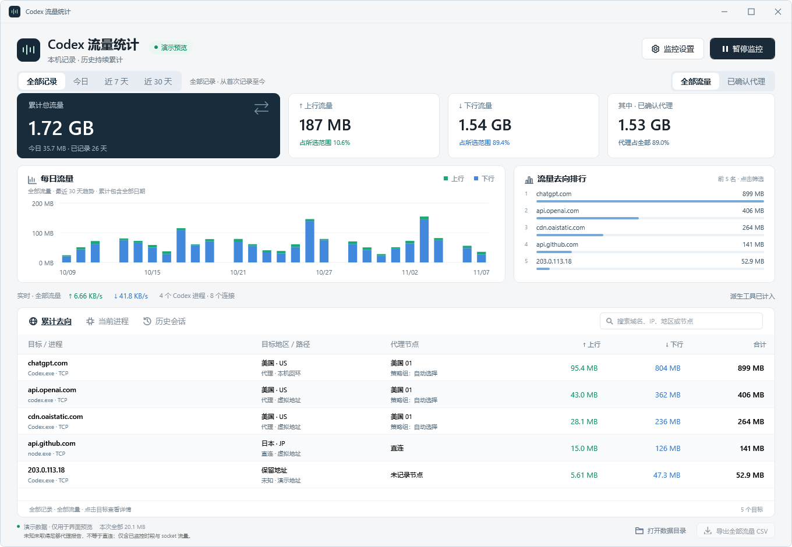

# Codex Traffic Monitor · Codex 流量统计

Windows 本地程序，累计记录 Codex 桌面端、CLI 和派生工具进程的上下行、目标地址、地区及代理节点。首页默认显示全部历史用量，重启后继续累计。程序自身不上传监控数据，不需要修改代理、安装根证书或解密 HTTPS。

[下载最新安装包](https://github.com/3356153957/codex-traffic-monitor/releases/latest) · [Windows 构建](https://github.com/3356153957/codex-traffic-monitor/actions/workflows/windows.yml) · [MIT 许可](LICENSE)



> 截图使用明确标注的演示数据，不包含用户的流量记录或代理配置。

## 安装

支持 Windows 10/11 x64，安装包自带 .NET 运行时。

1. 在 [Releases](https://github.com/3356153957/codex-traffic-monitor/releases/latest) 下载 `CodexTrafficMonitor-Setup-版本-win-x64.exe`。
2. 双击安装向导，选择安装位置和是否创建桌面快捷方式。默认安装到当前用户的 `%LOCALAPPDATA%\Programs\CodexTrafficMonitor`。
3. 打开程序，点击“以管理员身份开始”并确认 Windows UAC，开始记录。内核采集需要管理员权限，普通查看不需要。
4. 如需登录 Windows 后自动记录，在“监控设置”里开启“开机自动监控”。

安装/升级前，请从旧版“监控设置 → 退出程序”或托盘菜单退出；只关闭窗口会继续后台记录。新版之间可请求正常退出并保存，旧便携版不支持时安装器会提示手动退出，不会强制结束进程。此前启用的自启会迁移到安装路径，首次迁移可能需要一次 UAC；取消后可在监控设置里重新开启。

卸载可通过 Windows“已安装的应用”或开始菜单完成。卸载仅移除本安装路径对应的程序与自启，保留历史流量目录。当前发布未做代码签名，可用 Release 中的 `SHA256SUMS.txt` 核对下载文件。

也提供 `*-portable.zip` 免安装版，解压后运行 EXE。安装版与便携版共用当前用户的流量历史，同一用户只运行一个采集实例。

## 使用

1. 从开始菜单、桌面快捷方式或便携目录运行 `CodexTrafficMonitor.exe`。普通权限下可查看 Codex 的现有 TCP 连接，尚未采集的字节显示为 `—`。
2. 点击“以管理员身份开始”，通过 Windows UAC 后自动开始记录。内核流量采集需要管理员权限。
3. 首页突出累计总量、上行、下行和代理占比，今日用量位于累计卡片下方；可切换全部记录、今日、近 7 天、近 30 天。每日用量和去向排行随范围变化，本次会话位于底部。
4. 点击“暂停监控”停止当前采集；再次开始创建新会话，历史累计仍保留。关闭窗口或最小化会收起到系统托盘继续运行，右键托盘选择“退出”才结束程序并保存。未运行期间的流量无法补回。
5. “累计去向”支持搜索目标域名、IP、地区和节点；点击排行可筛选，搜索框右侧可一键清除。点击表格目标展开完整地址、进程、地区来源及代理链，可选择文字或复制全部详情。CSV 导出当前所选时间范围的去向汇总。

默认包含派生工具进程和回环连接。派生工具会计入由 Codex 启动的 shell、Python、Node、MCP 等。在右上角“监控设置”里，可在停止状态取消选项，选择会保存并用于下次启动；已有历史保留当时的采集范围，不会凭空补齐过去未记录的工具流量。

## 开机自动监控

在“监控设置”里勾选“开机自动监控”，首次设置通过一次 Windows UAC。程序创建仅属于当前用户的登录计划任务，以管理员权限在托盘后台自动开始采集，不保存登录密码。取消勾选即可移除这个任务，当前采集继续运行。

这里的开机指登录 Windows 后，不在未登录时运行。计划任务名称为 `CodexTrafficMonitor-<当前用户 SID>`，同一用户只运行一个记录实例，笔记本使用电池时也继续记录，且不设置自动结束时限。注销、关机会结束并保存当前会话。

保持可执行文件位置不变；移动后重新开启开关可更新路径。设置按系统任务实际状态显示，取消 UAC 不会误报已开启或已关闭。

## Dashboard

窗口顶栏与 Dashboard 统一为浅色，支持拖动、双击最大化、边缘调整大小。程序文件、窗口、任务栏和托盘使用统一图标，主要操作配有线性图标。监控设置中可直接退出程序并保存记录。

时间范围改为直接可选的分段按钮；累计卡片与趋势区域更紧凑，为去向表格腾出更多空间。地区与连接类型合并展示，流量数字右对齐。选中的连接详情、排序与滚动位置在刷新后保留。每日图坐标采用统一单位，悬停可查看明细，也可聚焦图表后用左右方向键、Home、End 查看日期，Esc 收起提示。无记录日期仍明确标注。

## 累计统计

累计读取正常数据目录内的全部历史会话与增量明细，不受历史表最多显示 100 条的限制。按每条记录的本地日期计算今日、近 7 天和近 30 天，跨午夜会话分日统计。当前会话已保存的字节只计一次。

每日图没有记录的日期标为“当天无记录”，不代表全天没有流量。若历史明细损坏，累计总量可使用会话摘要恢复，界面会提示部分流量无法分配日期或去向；不会把这些流量猜到某个日期或网站。

## 全部流量与代理流量

时间范围与流量范围分别选择。默认“全部流量”；切到代理范围后，累计、今日提示、每日图、去向排行、明细及 CSV 只显示代理流量，并与同日期范围内的全部流量对比。实时速率、当前进程和历史会话仍按全部采集口径显示。

全部流量 = 代理 + 已确认直连 + 未知。出站类型来自记录时的本机代理报告；明确的 `Direct` / `DIRECT` 不算代理。只有回环或虚拟 IP、但没有匹配的代理报告时属于未知，不能直接当作代理或直连。旧记录没有出站类型时，根据当时保存的非 DIRECT 节点/链路判断，并在分类依据里注明。摘要中缺少明细的流量差额也归到未知。

节点类型每 5 秒从本机控制器的 `/proxies` 和 `/providers/proxies` 只读刷新，覆盖订阅中的叶节点；同名节点出现冲突类型时保守标为未知。程序只保留名称与类型，不保存订阅配置。

该统计仍是进程 socket 字节，包含本机连接时可能两端计数，不等于代理服务商的计费流量。

## 去向和计量口径

- 采用 Windows ETW 的 TCP/UDP Send/Receive 传输字节，支持 IPv4 和 IPv6。不另行叠加重传事件，不统计完整网卡链路开销，不等同于运营商账单或 HTTP 正文大小。
- 回环连接可能是本地代理或本机服务。同组进程内部通信会分别出现发送方上行、接收方下行，因此这里是进程网络活动统计。需要纯外部口径时可取消“计入本机连接”，但经本机代理的 Codex 流量也会被排除。
- 如果 Codex 连接 `127.0.0.1:7897`，本程序能确认的是该代理下一跳。若连接 `198.18.0.0/15`，界面标记为虚拟地址，不将它当成已确认的公网网站。
- 域名可以从已有 Windows DNS 缓存关联，可能没有结果，也可能同一个 IP 对应多个名字，属于线索；不会主动查询 DNS。ETW 本身无法解密 HTTPS 或穿透代理确认最终网址。
- 若检测到本机 Clash Verge 的可用 Mihomo 控制器，会只读关联其 `/connections` 元数据，支持本机 HTTP 和 Windows 命名管道，在域名后标明“代理报告”。每 500 毫秒读取一次代理快照，短暂保留近期连接线索，并按连接开始时间和事件时间校验，减少短连接在写盘前消失造成的节点缺失。完全没被快照捕获的短连接和旧记录中的缺失仍无法补回。悬停可查看报告的目标和出口线路，日志同时保留直接连接地址。未配置、不可访问或匹配有歧义时不显示报告。不会修改代理设置；控制器凭据只在内存中使用，不写入记录或导出。
- 地区优先使用代理元数据，否则离线读取本机已有的 `Country.mmdb`，显示国家／地区级别的 IP 归属参考，不代表服务器的精确物理地址。某些库将 CDN 网段写成 `CLOUDFLARE` 等标签，这时会显示“网络：CLOUDFLARE”，明确与地理位置区分。回环、局域网和虚拟地址不会被猜成公网地区；无法查询时显示具体原因：本机地址、虚拟地址、目标 IP 未提供或暂无地区数据。可将自己的 MMDB 放到 `%LOCALAPPDATA%\CodexTrafficMonitor\geoip\Country.mmdb`。程序不向第三方 IP 查询服务发送地址。
- 代理节点取代理报告中的实际节点，代理节点下方显示所选策略组，完整链路可在连接详情里查看；地区与节点名称分别展示。代理只返回目标域名且不返回真实 IP 时，无法查询目标地区，也不能用节点名中的地区代替目标服务器地区。较旧记录没有地区字段时，可根据已保存的目标公网 IP 用本机库补充查询。
- 普通权限连接查看来自系统 TCP 表，不含 UDP 远端；管理员采集开始后的 TCP/UDP 才有实际字节记录。
- 若 ETW 丢事件，界面会显示丢失数量，统计可能偏低。写入失败会显示错误并停止采集。
- 正确识别安装路径属于 `OpenAI.Codex_*` 的 `ChatGPT.exe`，不会因同名将独立 ChatGPT 桌面端直接当作 Codex。

## 记录位置

`%LOCALAPPDATA%\CodexTrafficMonitor\sessions\<会话ID>\`

- `session.json` 保存会话总量、起止时间、统计范围、ETW 丢失数和异常状态。
- `flows.jsonl` 每秒写入连接增量，包含 UTC 时间、进程／路径、PID、协议、本机及目标 IP／端口、上行／下行原始字节。
- CSV 使用 UTF-8 BOM，可以直接用 Excel 打开；数值列是原始字节数。

记录持续累积，由用户自行备份或删除。每秒刷新记录；意外断电可能丢失最后一个尚未刷新的时间片，历史会话会显示未正常结束。

## 构建与核验

需要 Windows x64 和 .NET 8 SDK。`build.ps1` 优先使用此项目 `.tools\dotnet` 中的便携 SDK，不修改系统 SDK 安装。

```powershell
.\build.ps1
# 构建 EXE 安装包、便携 ZIP 和 SHA-256 校验文件
.\build-release.ps1
.\dist\CodexTrafficMonitor.exe --self-test .\output\self-test.json
.\dist\CodexTrafficMonitor.exe --preview .\output\ui-preview.png
.\dist\CodexTrafficMonitor.exe --preview-live .\output\live-connections.png
.\dist\CodexTrafficMonitor.exe --snapshot .\output\snapshot.json
.\dist\CodexTrafficMonitor.exe --dashboard-snapshot .\output\dashboard.json
.\dist\CodexTrafficMonitor.exe --dashboard-snapshot .\output\proxy-dashboard.json --traffic proxy
.\dist\CodexTrafficMonitor.exe --startup-status .\output\startup-status.json
```

`build-release.ps1` 从官方固定版本下载、校验并便携解包 Inno Setup 编译器到 `.tools`，不全局安装编译工具。也可通过 `-InnoCompiler` 指定已有编译器。打包输出位于 `output/release/`。

自测覆盖双向字节归集、协议隔离、历史重载、JSONL、CSV 和原生连接表读取；`--preview` 仅使用标明演示的数据。`--preview-live` 渲染本机真实连接查看界面，均在完成后退出。

管理员可运行短时真实 ETW 采集核验，输出独立的诊断记录：

```powershell
.\dist\CodexTrafficMonitor.exe --capture-probe .\output\live-capture.json --seconds 20
```

未提权时该诊断会明确报告权限不足，不会把连接列表当成已验证的字节统计。

## 技术参考与许可

- [Microsoft TraceEvent 源码与 MIT 许可](https://github.com/microsoft/perfview)
- [TCP/IP ETW 字段定义](https://learn.microsoft.com/en-us/windows/win32/etw/tcpip-typegroup1)
- [Windows 系统追踪会话权限](https://learn.microsoft.com/en-us/windows/win32/etw/configuring-and-starting-a-systemtraceprovider-session)
- [Get-DnsClientCache](https://learn.microsoft.com/en-us/powershell/module/dnsclient/get-dnsclientcache)

使用 Microsoft.Diagnostics.Tracing.TraceEvent 3.2.8、MaxMind.Db 5.2.0 和 .NET 8 Windows Desktop Runtime；自包含发布包带运行时，目标机器无需另外安装 .NET SDK。不打包用户自己的地理库和代理配置。第三方许可见发布目录 `THIRD-PARTY-NOTICES.txt`。

首页的信息层级参考 [Grafana 仪表盘设计指南](https://grafana.com/docs/grafana/latest/visualizations/dashboards/build-dashboards/best-practices/)；图表采用便于比较数量的长度与位置编码，参考 [NN/g 的仪表盘图表建议](https://www.nngroup.com/articles/dashboards-preattentive/)。

源码以 MIT 许可发布；第三方依赖保留各自许可，详见 [THIRD-PARTY-NOTICES.txt](THIRD-PARTY-NOTICES.txt)。本项目为独立工具，与 OpenAI 无隶属关系。
